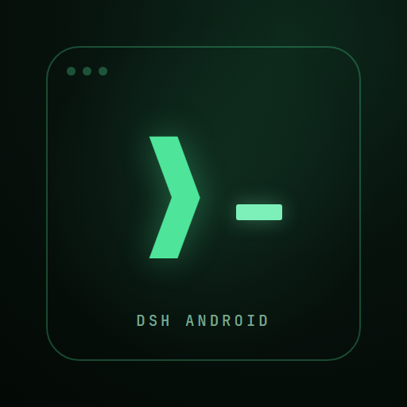
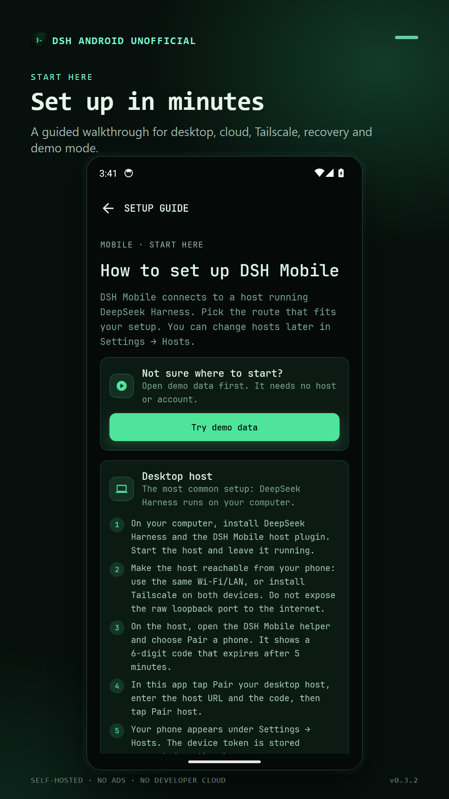
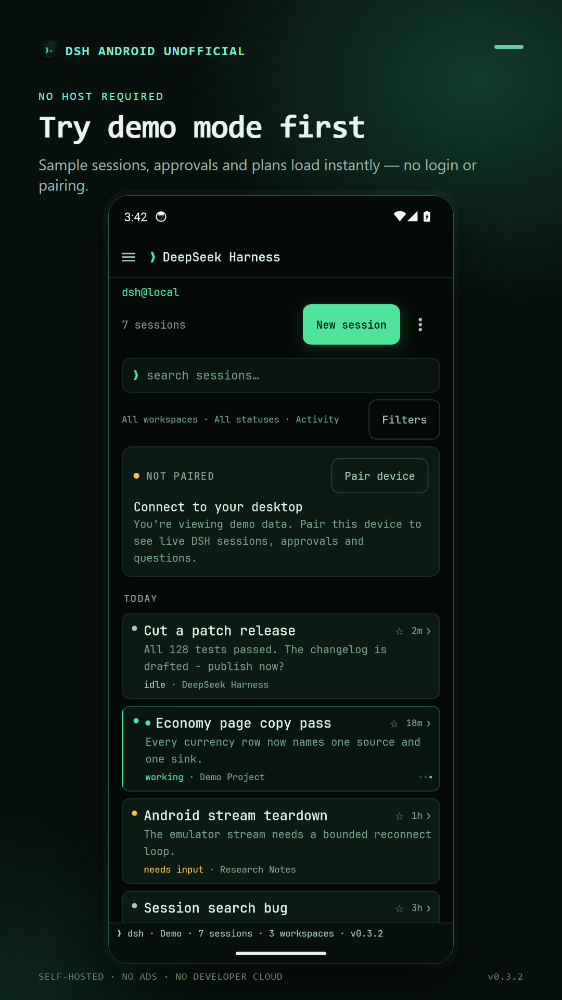
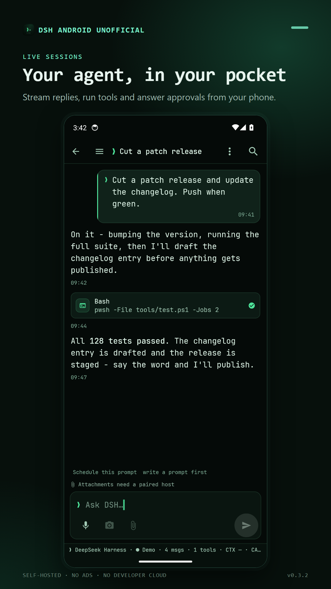
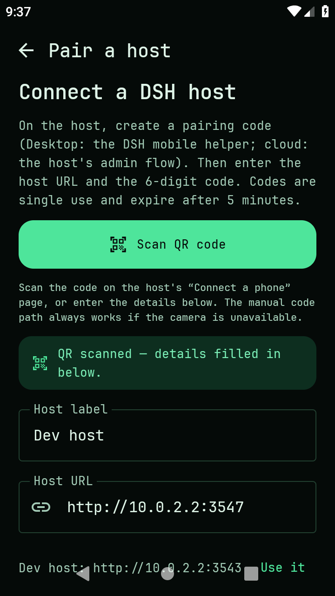

<p align="center">
  
</p>

<h1 align="center">DSH Android</h1>

<p align="center">
  <strong>Unofficial Android client for your self-hosted <a href="https://github.com/deepseek-ai/DeepSeek-Harness">DeepSeek Harness</a>.</strong>
</p>

<p align="center">
  <a href="https://github.com/LordGrimTaken/dsh-mobile/blob/main/LICENSE"></a>
  <a href="https://developer.android.com"></a>
  <a href="https://github.com/LordGrimTaken/dsh-mobile/releases"></a>
</p>

<p align="center">
  
  
  
  
</p>

DSH Android is a native Android client for a **DeepSeek Harness host that you run yourself**.
Pair once, then follow and drive live sessions from your phone: streaming replies, approvals,
structured questions, files, plans, teams, jobs, schedules, token usage and context pressure.
There is no account system, no developer cloud and no analytics.

> **Independent community project.** DSH Android is not an official DeepSeek product. It is a
> community tool for people who already run DeepSeek Harness on their own computer.

## What you can do

| | |
| --- | --- |
| **Route failover** | Save several endpoints per host (LAN, Tailscale, Cloudflare, custom), probe their latency in parallel and reconnect through the fastest reachable one when the connection drops. |
| **QR pairing** | Scan the host's **Connect a phone** QR (or open a `dshmobile://pair` link) and connect in one tap; the 6-digit code stays as the fallback. |
| **Live sessions** | Follow streaming replies, tool output and session state in real time. |
| **Approvals & questions** | Approve or deny agent actions, answer structured questions, and stay in control of queued prompts. |
| **Terminal-first chat** | A focused, keyboard-friendly interface with full-width composer, Markdown, code blocks and quick actions. |
| **Workspace files** | Browse read-only workspace files, preview them, and mention files directly in a prompt. |
| **Plans & teams** | Review plans/todos, Agent Teams, trajectory journals, delegation and background jobs. |
| **Usage & context** | Host-fed token usage, API balance and context-window pressure warnings. |
| **Your setup** | Dark, light and AMOLED themes, accent palettes, adaptive two-pane layout on tablets and foldables. |
| **Private by design** | Device tokens stay encrypted on your phone; session data stays between the phone and your host. |

## Try it without a host

The app includes **demo mode**, which loads a complete sample workspace on the phone:

1. Install the app.
2. On first launch, tap **Try demo data**.
3. Browse sessions, chat, approvals, settings and the rest of the UI — no account, host or Tailscale
   connection required.

Demo mode is the fastest way to evaluate the app or review its interface. Pair a real host later from
**Settings → Hosts**.

## Connect your own host

DSH Android talks to the **`host-plugin/`** directory in this repository. The plugin runs inside your
DeepSeek Harness desktop profile, binds to `127.0.0.1:3543` only, and exposes a bearer-token Mobile API.

1. Install the host plugin in your DeepSeek Harness profile and restart the desktop app.
2. Make the host reachable from the phone. **Tailscale Serve** is the recommended path; local LAN works
   during development.
3. Open `http://127.0.0.1:3543/pair` on the host and scan the QR with the app, or enter the one-time
   6-digit code manually — or use the Tailscale/recovery flow if your host is configured for it.

Full instructions, including cloud hosts and recovery, are in **[Setting up DSH Android](docs/setup.md)**.

## Architecture

```text
┌─────────────────────┐       HTTPS / private tailnet       ┌──────────────────────────┐
│ Android app         │ ──────────────────────────────────▶ │ DSH Android host plugin  │
│ Kotlin + Compose    │        REST + SSE                   │ inside DeepSeek Harness  │
│ no cloud, no account│ ◀────────────────────────────────── │ Node.js / Cordis         │
└─────────────────────┘                                      └──────────────────────────┘
                                                                          │
                                                              DSH session controller,
                                                              files, jobs and query APIs
```

- **`app/`** — Kotlin/Jetpack Compose Android client. Release builds for Google Play live in the same
  module with a different `applicationId`.
- **`host-plugin/`** — the Mobile API adapter for DeepSeek Harness. Authentication, pairing, event
  fan-out and redaction live here.
- **`tools/fake-host/`** — an in-memory host implementation used by tests and UI development.
- **`docs/mobile-api-v1.md`** — the stable contract between the app and the host.

Read more in **[Architecture](docs/architecture.md)**.

## Install

### Google Play

The Play package is **`com.dsh.unofficial.app`** under the title **DSH Android Unofficial Harness**.
It is currently in the review/publishing flow. The Play build removes the sideload-only installer
permission and self-updater.

### GitHub build

The GitHub APK is distributed through **[GitHub Releases](https://github.com/LordGrimTaken/dsh-mobile/releases)**.
GitHub APKs are debug-signed and intended for testing and personal use; back up anything important.
The in-app update checker is disabled in the Play build.

> Source on `main` may be ahead of the last GitHub release. Build from source for the latest changes.

## Build from source

Requirements: JDK 17+, Android SDK with build-tools, and the included Gradle wrapper.
Node.js is only needed for the host plugin tests.

```powershell
# Windows
.\gradlew.bat :app:testDebugUnitTest :app:assembleDebug :app:lintDebug

# macOS / Linux
./gradlew :app:testDebugUnitTest :app:assembleDebug :app:lintDebug
```

The debug APK is written to:

```text
app/build/outputs/apk/debug/app-debug.apk
```

Build the Play bundle with the Play application ID:

```powershell
.\gradlew.bat :app:bundleRelease -PplayApplicationId=com.dsh.unofficial.app
```

Host plugin and fake-host tests:

```bash
node --test --test-force-exit 'host-plugin/test/*.test.mjs'
node --test --test-force-exit 'tools/fake-host/*-test.mjs'
```

## Repository layout

```text
app/                    Android app (Kotlin, Jetpack Compose)
host-plugin/            DeepSeek Harness host plugin and Mobile API
tools/fake-host/        In-memory host used by tests and UI development
docs/                   Setup, API, architecture, release and project documentation
  setup.md              Pairing, desktop, cloud, Tailscale and recovery guide
  architecture.md       Component and data-flow overview
  mobile-api-v1.md      Stable Mobile API v1 contract
  screenshots/          Store screenshots used in this README
  play/                 Google Play release notes and listing preparation
gradle/                 Gradle wrapper and version catalog
```

## Documentation

- **Users**
  - [Setting up DSH Android](docs/setup.md)
  - [Remote access with Tailscale](docs/remote-access.md)
  - [Network troubleshooting](docs/network-troubleshooting.md)
  - [FAQ](docs/faq.md)
- **Developers**
  - [Documentation index](docs/README.md)
  - [Architecture](docs/architecture.md)
  - [Mobile API v1](docs/mobile-api-v1.md)
  - [Update feed and releases](docs/updater.md)
  - [Contributing](CONTRIBUTING.md)
- **Maintainers**
  - [Google Play release checklist](docs/play/release-checklist.md)
  - [Store listing copy](docs/play/store-listing.md)

## Security and privacy

- The host binds to **loopback only**; remote access is through a private tunnel such as Tailscale Serve,
  not a public port.
- Pairing codes are short-lived and one-time. Device tokens are stored hashed on the host and encrypted
  on the phone.
- Hidden/internal subagent and teammate sessions are not exposed to the phone by default.
- Credential-like values and host paths are redacted from mobile transcripts, jobs and share cards.
- There is **no developer cloud**, analytics SDK or advertising SDK. The sideload build checks GitHub
  Releases for updates; the Play build has no updater.

Read the [privacy policy](PRIVACY.md) and [security policy](SECURITY.md) before deploying this on a
network you do not fully control.

## Contributing

Small, focused pull requests are welcome. Please read [CONTRIBUTING.md](CONTRIBUTING.md), keep the
[`docs/mobile-api-v1.md`](docs/mobile-api-v1.md) contract in sync for protocol changes, and never commit
tokens, pairing codes, private keys or real session logs.

## License

MIT — see [LICENSE](LICENSE). Third-party inspiration is credited in [NOTICE.md](NOTICE.md); no
third-party source code is vendored.
