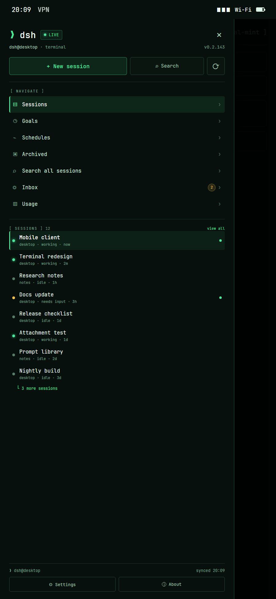

# DSH Mobile

A native Android client for a **DeepSeek Harness** host running on your own PC. Pair once, then read and drive your live DSH sessions from your phone — chat, approvals, questions, files, plans, teams, jobs, schedules, usage and context — without syncing your sessions to a third-party cloud.

> **Status: preview.** The app is distributed as a **debug-signed APK** from GitHub Releases. It is usable for testing and personal use; expect rough edges and back up anything important. This is an independent community project, not an official DeepSeek product.

[Download the latest APK](https://github.com/LordGrimTaken/dsh-mobile/releases/latest)



*Design example of the terminal cockpit drawer: compact actions, one navigation section, live session rows with status/unread/current state.*

 · [Mobile API contract](docs/mobile-api-v1.md) · [Host plugin](host-plugin/README.md) · [Build from source](#build-from-source) · [Feature ideas](docs/mobile-feature-ideas.md)

---

## What it does

DSH Mobile talks to a small **host plugin** that runs inside the DeepSeek Harness desktop profile. The plugin binds only to loopback and exposes a bearer-token Mobile API; the phone reaches it through Tailscale (recommended), another private tunnel, or the local network during development.

| Area | Capabilities |
| --- | --- |
| **Sessions** | Live session list, unread/working states, search and filters, rename, archive/hide, grouped workspaces |
| **Chat** | Streaming replies, Markdown/code, attachments and images, PDF export, tool-output viewer, queued prompts, stop/interrupt |
| **Approvals & questions** | Live approval policy, approve/deny, structured questions with answers |
| **Files** | Read-only workspace browser, previews, external open, **Mention in prompt** |
| **Oversight** | Plan/todos, team board, trajectory journal, background jobs, lineage/delegation, skills |
| **Usage & context** | Host-fed token usage and API balance, context-window pressure with warnings |
| **Automation** | Schedules, goals, recovery pairing, push notification preferences |
| **Presentation** | Terminal-first UI with compact shell and single-line status; dark/light/AMOLED, six accent themes, adaptive two-pane layout on tablets/foldables, share-message-as-image cards, configurable text size |
| **Resilience** | SSE reconnect diagnostics, snapshot cache, startup-recovery screen, crash reports |

## Architecture

```text
┌──────────────────────┐        HTTPS (Tailscale Serve)        ┌────────────────────────────┐
│ Android app          │ ───────────────────────────────────▶ │ DSH Mobile host plugin     │
│ Kotlin + Jetpack     │       127.0.0.1:3543 (loopback)       │ inside DeepSeek Harness    │
│ Compose, no cloud    │ ◀────────── SSE + REST ───────────── │ Node.js / Cordis           │
└──────────────────────┘                                       └────────────────────────────┘
                                                                         │
                                                              DSH session controller,
                                                              query, attachments, files
```

- The host plugin is in [`host-plugin/`](host-plugin/README.md). It owns the Mobile API, pairing codes, device tokens, event fan-out and redaction.
- The Android app is in [`app/`](app/). It has no analytics, no account system and no server-side component; your host is the only backend.
- [`tools/fake-host/`](tools/fake-host/README.md) is an in-memory implementation of the same contract for UI development and tests.

## Google Play (prepared, not yet listed)

A Google Play build is prepared in this repository but has not been uploaded or listed yet. It targets Android SDK 36, uses the upload key described in `docs/play/release-checklist.md`, removes the sideload-only APK installer permission and updater, and keeps the same privacy model.

- Play checklist: [`docs/play/release-checklist.md`](docs/play/release-checklist.md)
- Store listing copy: [`docs/play/store-listing.md`](docs/play/store-listing.md)
- Privacy policy: [`PRIVACY.md`](PRIVACY.md)
- App access/reviewer notes: [`docs/play/app-access.md`](docs/play/app-access.md)
## Install the app

1. On your phone, open the [latest release](https://github.com/LordGrimTaken/dsh-mobile/releases/latest) and download the `dsh-mobile-*-debug.apk` asset.
2. Allow installs from your browser/file manager when prompted.
3. Open DSH Mobile. The first screen lets you pair with a host.

The APK is **debug-signed**. In-app updates only install when the new APK has the same signature; the release feed and update checker are documented in [`docs/updater.md`](docs/updater.md). Uninstall/reinstall may be required if you mix builds signed with different keys.

## Install the host plugin

The host plugin runs inside the DeepSeek Harness desktop profile. Copy or install [`host-plugin/`](host-plugin/README.md) as a DSH profile bundle, enable it, and restart the desktop app. It listens on `127.0.0.1:3543` only; do not expose that port directly to the internet.

For remote access, the recommended setup is **Tailscale Serve**, which provides TLS and tailnet-only reachability without opening a port:

- [Remote access guide](docs/remote-access.md)
- [Network troubleshooting](docs/network-troubleshooting.md)

To pair: in the desktop host, create a pairing code (or use Tailscale/recovery pairing according to the host plugin configuration), then enter it in the app. The app stores the issued device token in Android Keystore-backed encrypted storage.

## Security and privacy

- **Loopback only:** the host API binds to `127.0.0.1`; remote exposure is via Tailscale Serve, not a public port.
- **Device bearer tokens:** each phone gets its own token through a one-time code. Tokens are stored hashed on the host.
- **Hidden internal sessions:** subagent/teammate sessions are not exposed to the phone by default.
- **Redaction:** transcripts, trajectory, jobs and share cards redact credential-like values and absolute host paths before leaving the host or being rendered.
- **No cloud sync:** session content lives on your host and phone only. The app contacts your host plus the GitHub release feed when checking for updates.
- **Debug signing:** preview builds are not production-signed; do not distribute them as a trusted production app.

See [`SECURITY.md`](SECURITY.md) for reporting and limitations.

## Build from source

Requirements: JDK 17+, Android SDK with build-tools, and the Gradle wrapper (included).

```powershell
# Windows
.\gradlew.bat :app:testDebugUnitTest :app:assembleDebug :app:lintDebug

# macOS / Linux
./gradlew :app:testDebugUnitTest :app:assembleDebug :app:lintDebug
```

APK output: `app/build/outputs/apk/debug/app-debug.apk`.

Host plugin tests use Node.js (no dependencies):

```bash
node --test --test-force-exit 'host-plugin/test/*.test.mjs'
node --test --test-force-exit 'tools/fake-host/*-test.mjs'
```

## Repository layout

| Path | Contents |
| --- | --- |
| `app/` | Android app (Kotlin, Jetpack Compose) |
| `host-plugin/` | DSH host plugin implementing Mobile API v1 |
| `tools/fake-host/` | Contract-compatible fake host for development/tests |
| `docs/mobile-api-v1.md` | Stable Mobile API contract |
| `docs/mobile-feature-ideas.md` | 200 researched feature ideas with priority/API tags |
| `docs/updater.md` | Release feed and update-checker details |
| `NOTICE.md` | Third-party inspiration and licensing notes |

## License

MIT — see [`LICENSE`](LICENSE). Third-party inspiration is credited in [`NOTICE.md`](NOTICE.md); no third-party source code is vendored.
